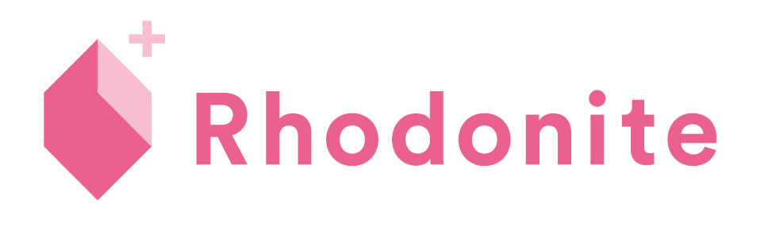
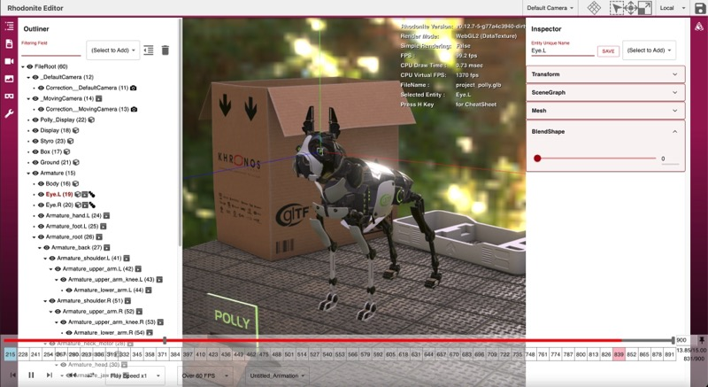
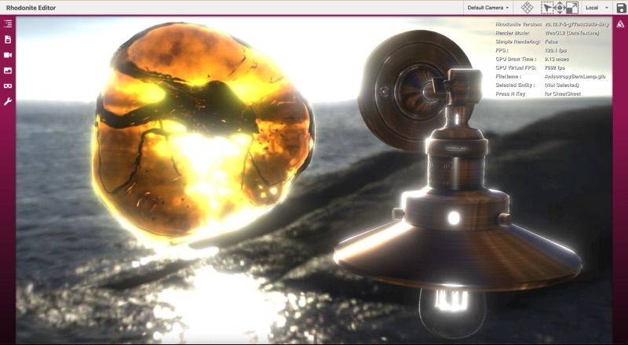
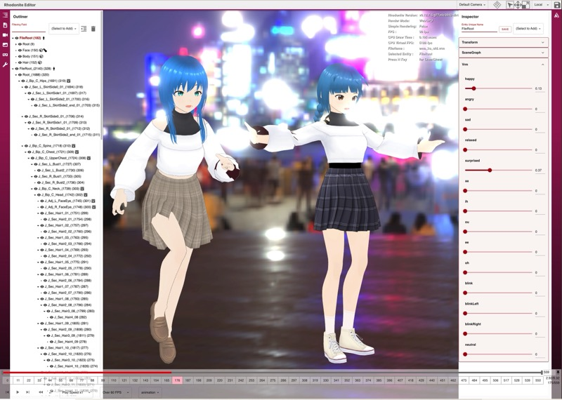
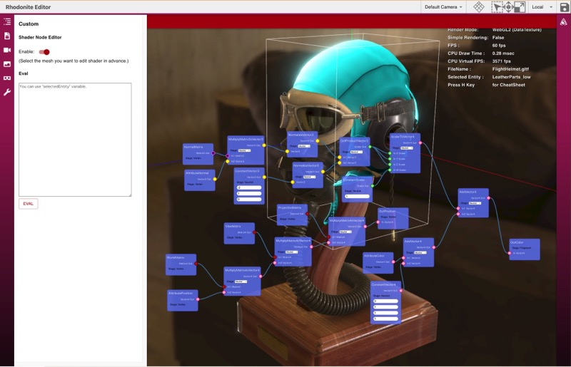
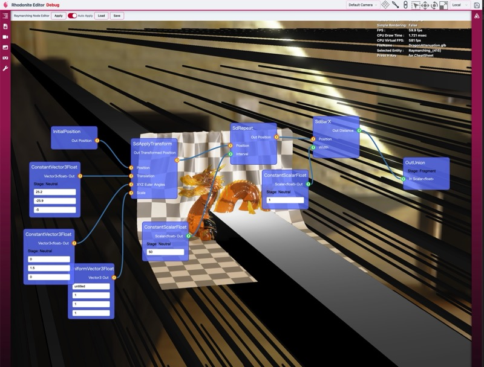
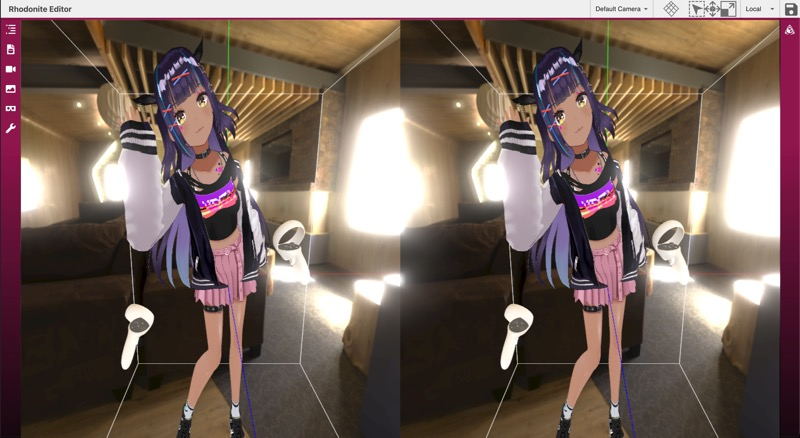

# Rhodonite



Rhodonite is a Web3D(WebGL2/WebGPU) library written in TypeScript.


## Official Website

https://librn.com/

## Features

* Component-oriented
* Blittable Memory Architecture (Original GPU data storage system with floating point texture)
* Physically-based Rendering with Image-based Lighting
* Node-based Shader System
* Node-based Raymarching System (with integration to polygon rendering)
* Support loading the following 3D model files: [glTF2](https://github.com/KhronosGroup/glTF), glTF1, [VRM](https://vrm.dev/en/)
* Support [Draco compression](https://google.github.io/draco/), [Basis Universal](https://github.com/BinomialLLC/basis_universal) and [KTX2](http://github.khronos.org/KTX-Specification/), etc
* Support [Effekseer](https://effekseer.github.io/en/) for particle system
* WebGPU Support
* WebXR(VR) Support (in both WebGL & WebGPU)

## What's the "Blittable Memory Architecture"


With the Blittable Memory Architecture, Rhodonite stores almost all of its data in a large pre-allocated ArrayBuffer. Data storage for matrix or vector classes in Rhodonite's component classes and materials are assigned from the memory pool, which means most of the data are on that memory pool, transferred to the GPU every frame as a floating-point texture.
This architecture allows all shaders always to access a vast amount of data.

For example, Rhodonite can handle and blend all morph targets (38 targets) of VRM characters simultaneously in the shader.

## Viewer

You can try our library via https://editor.librn.com/.
This viewer supports glTF/VRM/efkpkg(Effekseer package) files Drag & Drop to display.
(Drag & Drop all files if glTF data consists of multiple files.)

Poly model


Advanced PBR


VRM avatar model and VRMA animation


Shader Node Editor


Raymarching Node Editor (with integration to polygon rendering)


WebXR(VR) with [multiview](https://developers.meta.com/horizon/documentation/web/web-multiview/) extension


## Supported Browsers

Google Chrome, Firefox, Safari, Microsoft Edge (chromium-based), and other modern browsers are supported.
IE11 is not supported.

## Install

You can install Rhodonite easily.

```bash
$ npm install rhodonite
```

### Note

If you get an error like "webxr-input-profiles not found" when building a project using Rhodonite, Try "npm install" or "pnpm install" again.

## Coding with Rhodonite

### In JavaScript

```html
<body>
  <canvas id="world"></canvas>
  <script src="../../../dist/iife/rhodonite.min.js"></script>
  <script>
  // Init Rhodonite
  const engine = await Rn.Engine.init({
    approach: Rn.ProcessApproach.DataTexture,
    canvas: document.getElementById('world'),
  });

  // create a Plane mesh
  const planeEntity = Rn.MeshHelper.createPlane(engine);
  planeEntity.eulerAngles = Rn.Vector3.fromCopy3(Math.PI * 0.5, 0, 0);

  // Render Loop
  engine.startRenderLoop(() => {
    engine.processAuto();
  });
  </script>
</body>
```

### In TypeScript

There are two package versions of Rhodonite: ESModule and IIFE.

#### Using ESModule package

You don't need any bundler.

```html
<script type="module" src="main.js">
```

```typescript
// main.ts
import Rn from 'rhodonite/dist/esm/index.js';
// import Rn from 'rhodonite/dist/esmdev/index.js'; // use this if you want to display the source map or step through the library

// Init Rhodonite
const engine = await Rn.Engine.init({
  approach: Rn.ProcessApproach.DataTexture,
  canvas: document.getElementById('world') as HTMLCanvasElement,
});

// create a Plane mesh
const planeEntity = Rn.MeshHelper.createPlane(engine);
planeEntity.eulerAngles = Rn.Vector3.fromCopy3(Math.PI * 0.5, 0, 0);

// Render Loop
engine.startRenderLoop(() => {
  engine.processAuto();
});
```

```
// tsconfig.json
{
  ...
  "compilerOptions": {
    "module": "ESNext",
    "moduleResolution": "node",
    "esModuleInterop": true,
    ...
  }
  ...
}
```

If you use bundler, you can simply import rhodonite, like

```
import Rn from 'rhodonite';
```

#### Using IIFE package

See the last part of https://github.com/actnwit/RhodoniteTS/wiki/Install .

## Building Rhodonite

### Prerequisites

* Node.js 22 or later

### Setup Project

```bash
$ pnpm install
```

### Build command for Rhodonite library

```bash
$ pnpm run build
```

### Build command for samples

```bash
$ pnpm run build-samples
```

## Try Samples

After building Rhodonite, try:

```bash
$ pnpm run watch-samples
```

Then, access http://localhost:8082/ with your web browser.
When you are finished, press ctrl + c.

## Build command for API documents

```bash
$ pnpm run doc
```

## Testing Rhodonite

The following command runs unit tests and E2E tests.

```bash
$ pnpm run test
```

The E2E test uses a headless browser for rendering. The reference images are generated in the CI environment: Ubuntu + Mesa's software stack (llvmpipe for GL/WebGL2, lavapipe for Vulkan) and Chromium's "WebGPU on Vulkan via GL interop" path, which is what makes WebGPU canvases capturable without a GPU. That environment is available locally as a Docker container, so the strict check and the reference images are reproducible on any machine:

```bash
$ pnpm test-e2e:docker          # strict run in the reference environment
$ pnpm test-e2e:docker:update   # regenerate all reference images
```

Running the suite natively (for example on macOS with a real GPU) renders slightly differently from the software rasterizer (measured at up to ~1%, mostly IBL samples), so native runs apply a 2% tolerance floor (`E2E_NON_REFERENCE_FAILURE_THRESHOLD`). CI runs on the `ubuntu-24.04-arm` runner and compares with the same strict thresholds as the container (`E2E_REFERENCE_FAILURE_THRESHOLD`, default `0`); the arm64 image is used because llvmpipe renders slightly differently on x64. If a hosted runner ever renders differently from the machine that generated the reference images, that floor can be raised for CI only.

If a Linux environment cannot provide the GL/Vulkan interop (no Mesa, or the flags are opted out), WebGPU canvases stay blank. In that case run the WebGPU cases as smoke tests:

```bash
$ E2E_WEBGPU_SMOKE=1 pnpm run test-e2e
```

With `E2E_WEBGPU_SMOKE=1` the WebGPU samples only have to reach their render loop; no screenshot comparison is performed.

The E2E runner passes the Mesa-specific flags automatically on Linux. Set `E2E_SOFTWARE_RENDERING=0` to opt out, or `PUPPETEER_EXECUTABLE_PATH` to use a specific Chrome binary. `E2E_REFERENCE_FAILURE_THRESHOLD` (percent, default `0`) is a tolerance floor for the reference environment; CI sets it to `5` because GitHub's hosted runners use a different CPU/instance than the machine that generated the reference images (a few sensitive samples differ by up to ~3.5%). `E2E_NON_REFERENCE_FAILURE_THRESHOLD` (default `2`, percent) is the floor used outside the reference environment; `E2E_REFERENCE_ENVIRONMENT=0` forces that floor on Linux too.

You can execute a part of tests like this.

### For unit test

```bash
$ pnpm run test-unit-part -- ./src/foundation/core
```

```bash
$ pnpm run test-unit-part -- ./src/foundation/core/Entity.test.ts
```

### For E2E (visual) test

```bash
$ pnpm run test-e2e-part -- ./samples/test_e2e/DataTextureInstancedDrawing
```

### Running the E2E suite in the CI environment (Docker)

The E2E job runs on `ubuntu-latest` with Mesa's software stack (llvmpipe for GL, lavapipe for Vulkan). To reproduce exactly the same environment on any machine with Docker:

```bash
$ pnpm test-e2e:docker          # run the full E2E suite in the container
$ pnpm test-e2e:docker:update   # regenerate all reference images in the container
$ pnpm test-e2e:docker:shell    # open a shell inside the container
```

The repository is mounted into the container, but `node_modules`, `dist`, the pnpm store and the Puppeteer browser cache live in Docker volumes, so the host installation is never modified. The first run builds the image and downloads Chrome (a few minutes); later runs only rebuild the library and run the tests.

The reference images are generated by this container (`pnpm test-e2e:docker:update`), so the container is the source of truth: it compares strictly against them, while native runs apply the tolerance floor described above.

## Development using VSCode devcontainer

This project supports the VSCode devcontainer for any docker-installed OS.

Input the following command in the VSCode command palette.

```bash
> Remote-Containers: Reopen in Container
```

After a new dev container window opens, You can work in the Debian Linux container environment. All dependencies (node, npm, pnpm, typescript, chromium, and all packages for Rhodonite) are already set up.

## Debugging inside VSCode (Step execution in VSCode Debug tab)

1. Install the "Debugger for Chrome" VSCode Extension.
2. Start the local server with `$ pnpm start`.
3. Push the run icon by choosing "Launch Chrome to debug Rhodonite samples" in the RUN tab of VSCode's left pane to start debugging.

If you use the VSCode devcontainer environment, You should open another RhodoniteTS VSCode window locally and do debug ops on it instead of the devcontainer VSCode window.

## Contributing

See [CONTRIBUTING.md](CONTRIBUTING.md) for guidelines on setting up the project, running tests and submitting pull requests.

## License

MIT License

## Acknowledgements

### Source Code

This library includes portions of code originally developed by the Khronos Group.
Some of these portions have been translated and modified for use in the RhodoniteTS library.
- glTF-Sample-Renderer (https://github.com/KhronosGroup/glTF-Sample-Renderer)

See [LICENSES/glTF-Sample-Renderer.LICENSE](LICENSES/glTF-Sample-Renderer.LICENSE) for details.

### Libraries

This library uses the following libraries.

* [immersive-web/webxr-input-profiles](https://github.com/immersive-web/webxr-input-profiles) (forked version)
* [enkimute/hdrpng.js](https://github.com/enkimute/hdrpng.js)
* [donmccurdy/KTX-Parse](https://github.com/donmccurdy/KTX-Parse)
* [donmccurdy/zstddec-wasm](https://github.com/donmccurdy/zstddec-wasm)

### Assets

This library also uses the following assets.

* [KhronosGroup/glTF-Sample-Assets](https://github.com/KhronosGroup/glTF-Sample-Assets)

### Contributors


